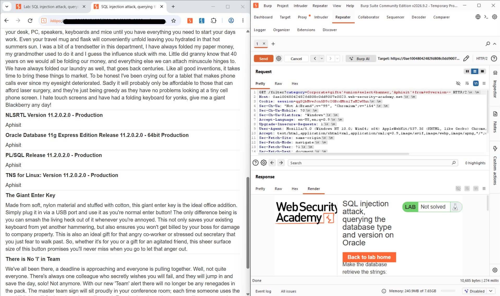

# Burp Suite & PortSwigger Web Security Academy Setup

## Overview

This setup was used for learning web application security through PortSwigger Web Security Academy labs with Burp Suite Community Edition.

The environment includes:

- PortSwigger Web Security Academy Account
- Burp Suite Community Edition
- Web Browser (Chrome/Edge)
- Burp Repeater for request analysis and testing

---

## Lab Workflow

### 1. Access Lab

Launch a lab from PortSwigger Web Security Academy and interact with the application through a web browser.

### 2. Intercept Request

Capture HTTP requests using Burp Suite Proxy.

### 3. Send to Repeater

Forward interesting requests to the Repeater module for further analysis.

### 4. Modify Request

Edit parameters, headers, cookies, or payloads inside Repeater to observe how the application handles different inputs.

### 5. Analyze Response

Review server responses and application behavior to understand how vulnerabilities can be identified in a controlled lab environment.

---

## Screenshot

---

## Skills Practiced

- Burp Suite Fundamentals
- HTTP Request Analysis
- HTTP Response Analysis
- Request Manipulation
- Repeater Usage
- Web Application Security Testing
- PortSwigger Web Security Academy Labs

---

## Learning Outcome

This lab environment helped develop practical experience in:

- Understanding web application communication
- Capturing and analyzing HTTP traffic
- Modifying requests using Burp Repeater
- Testing application behavior safely in a training environment
- Building hands-on web security assessment skills

---

## Disclaimer

All activities were performed within PortSwigger Web Security Academy's authorized training environment for educational purposes only.
