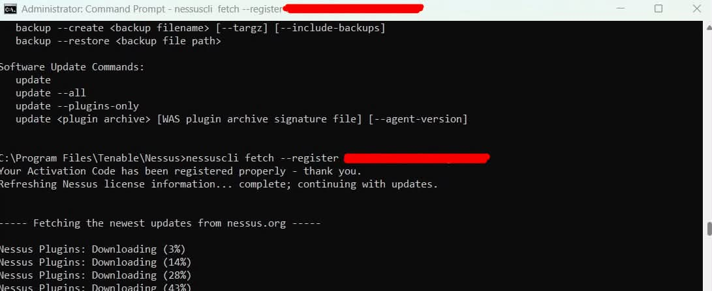
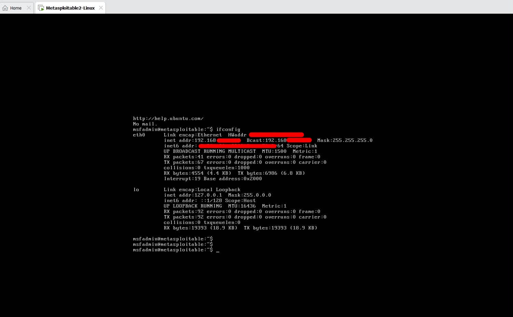
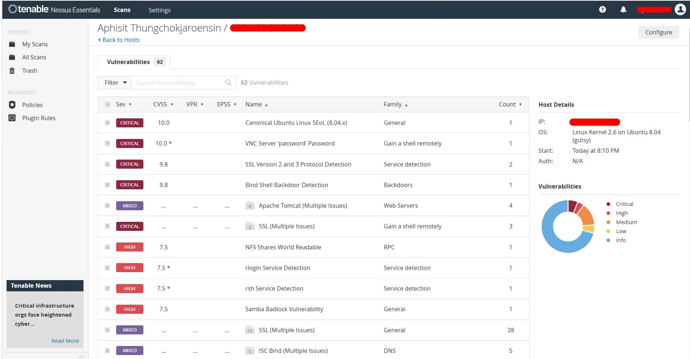

# Nessus Essentials Vulnerability Assessment Lab

## Overview

This lab demonstrates the process of re-activating Nessus Essentials, updating plugins, identifying a target system, and performing a vulnerability assessment against Metasploitable2 in a controlled lab environment.

---

## Lab Environment

- Windows 11
- Nessus Essentials
- Metasploitable2
- VMware Workstation

---

## Step 1: Re-Activate Nessus Essentials License

The Nessus Essentials license expired and prevented new scans from running.

A new activation code was registered using the Nessus command-line utility.

### Command

```cmd
nessuscli fetch --register XXXXX-XXXX-XXXX-XXXX-XXXX
```

### Screenshot



### Result

- Successfully registered a new activation code
- Refreshed Nessus license information
- Downloaded updated vulnerability plugins

---

## Step 2: Verify Target IP Address

Before starting the vulnerability assessment, the target IP address was identified from the Metasploitable2 virtual machine.

### Command

```bash
ifconfig
```

### Screenshot



### Purpose

- Identify the target IP address
- Verify network connectivity
- Prepare the scan target

---

## Step 3: Vulnerability Assessment

After updating Nessus and confirming connectivity, a vulnerability scan was performed against the Metasploitable2 target.

### Screenshot



### Activities

- Created a new scan
- Added the target IP address
- Executed the assessment
- Reviewed vulnerability findings
- Analyzed severity levels

### Findings

The scan identified multiple vulnerabilities commonly found in intentionally vulnerable systems such as Metasploitable2.

Examples include:

- Outdated services
- Weak configurations
- Known vulnerabilities
- Exposed network services

---

## Skills Practiced

- Vulnerability Assessment
- Vulnerability Scanning
- Nessus Administration
- License Management
- Plugin Updates
- Linux Enumerationained hands-on experience with:

- Re-activating Nessus Essentials using the command line
- Updating vulnerability plugins
- Identifying target systems
- Conducting vulnerability assessments
- Reviewing and analyzing scan results

---

## Disclaimer

All activities were performed within an isolated laboratory environment using Metasploitable2 for educational and cybersecurity learning purposes only.
